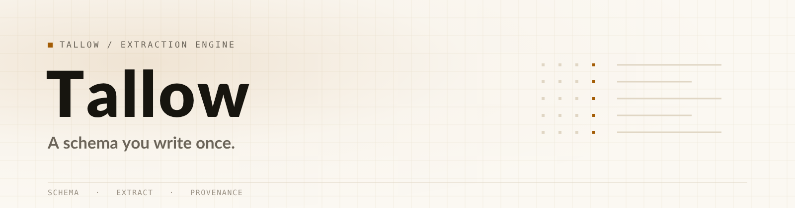
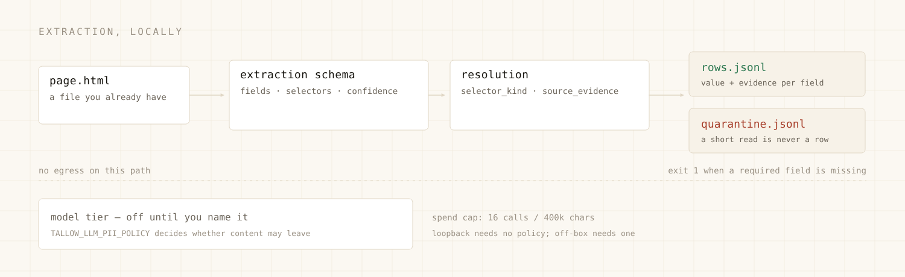
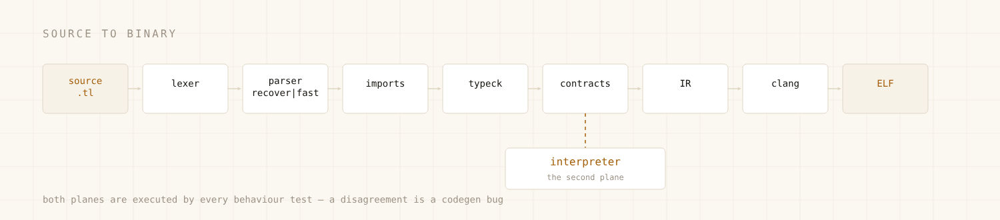

<div align="center">

<picture>
  <source media="(prefers-color-scheme: dark)" srcset="assets/sphere-hero-dark.png">
  <source media="(prefers-color-scheme: light)" srcset="assets/sphere-hero-light.png">
  
</picture>

**A schema you write once, applied to a page you already have — no model, no API key, no network.**

<sub><a href="#extraction-in-five-minutes">Extraction</a> &nbsp;·&nbsp; <a href="#install">Install</a> &nbsp;·&nbsp; <a href="#the-language-underneath">The language</a> &nbsp;·&nbsp; <a href="#architecture">Architecture</a> &nbsp;·&nbsp; <a href="#building-from-source">Build</a> &nbsp;·&nbsp; <a href="#hosting-and-deployment">Deploy</a> &nbsp;·&nbsp; <a href="#what-it-does-not-do-yet">Limits</a></sub>


[](https://github.com/aamirmanisa/tallowsphere/actions/workflows/ci.yml)

</div>

---

This repository is **the extraction engine of the Tallow language/runtime, published as the source tree it lives in.** Tallow is a statically typed systems language with an anti-bot scraping and OSINT runtime; this line of work is the schema-first extraction stack — its bindings in the compiler, HAR import, provenance records, and the CLI verbs that drive them.

Two properties shape everything here.

**Extraction is schema-first and local.** A contract is applied to an HTML file you already have. No LLM, no API key, no engine, no egress. The model-backed tier exists for pages a selector cannot cover, and it stays off until you name an engine and a policy that permits the transfer.

**Nothing fails quietly.** A page that misses a required field writes no row and exits `1`. A refusal names its reason. A short read is an error, not a truncated string.

## Three surfaces, one tree

| You came for | Entry point | What is verified |
|---|---|---|
| **Extraction** | `tallow schema check`, `tallow extract`, `tallow plan dry-run` | [`schemas/tallow/examples/`](schemas/tallow/examples/), and the row contract in `src/cli/extract_cmd.rs` — the `docs/extraction-engine/` documents were removed from the tree on 2026-10-31 ([record](MANIFEST.md)) |
| **The language** | `tallow check`, `build`, `run --interpret`, `fmt`, `lint` | [`conformance/`](conformance/), [`docs/spec/`](docs/spec/) |
| **Operations** | `tallow-reader`, `tallow-daemon`, `tallow-locator`, `tallow-jobs` | [`crates/`](crates/), [`docs/operations/`](docs/operations/) |

## Extraction in five minutes

```console
$ cargo build --bin tallow        # or install a release, below

$ ./target/debug/tallow schema check \
    schemas/tallow/examples/product-listing.extraction.schema.json
ok: … — tallow.extraction_schema.v1, 3 field(s)

$ ./target/debug/tallow extract \
    --schema schemas/tallow/examples/product-listing.extraction.schema.json \
    --html /tmp/product.html --out /tmp/out
extract: 1 item(s) → 1 row(s)
  rows:       /tmp/out/run-<pid>.rows.jsonl
  quarantine: /tmp/out/run-<pid>.quarantine.jsonl
  schema: example.product_listing.v1 (no egress performed)
```

[measured 2026-10-31 · `tallow 1.6.0` at `62ecd79` · `schema check` exit 0. `extract` exited 0 with
one row against a fixture whose three fields all resolve, and — against the same schema on a page
without the `<a>` that supplies the optional `url` field — still exit 0, with `unknown: product: field
"url" not yielded by selector ".product a"` on stderr. That row is `"status":"quarantined"`
(`row_confidence` 0.667, below the schema's `quality.min_row_confidence` 0.75) and is written to
**both** files, byte-identical (`md5sum` equal); the quarantine file is empty only when no row
is quarantined.]

Each line of `run-<pid>.rows.jsonl` is a `tallow.extraction_row.v1` object. Every field records its `value`, the `selector` that produced it, its `selector_kind`, its `confidence`, and `source_evidence` — a row you can argue with rather than only trust.

`rows.jsonl` carries **every** row; `<pid>.quarantine.jsonl` carries the quarantined subset, and the
two are byte-identical when every row is quarantined. Status is decided by the contract's own `quality`
block, and there are two ways in: `row_confidence` below `quality.min_row_confidence`, or more null
required fields than `quality.max_null_required_fields`. A quarantined row still counts in the `→ N
row(s)` line, still exits `0`, and is **not** a refusal — it is a record of a partial extraction that
you can filter on `"status"` [measured 2026-10-31, `tallow 1.6.0` at `0eed9d1`].

Two limits of this path, named rather than rounded off:

- **A missing required field does not exit 1 here.** `src/cli/extract_cmd.rs:52` returns `0` once rows
  are written; the only exit-`1` paths are a contract that yields no item at all and an unloadable
  contract. A page with no `.product .name` produced `1 row(s)`, `"status":"quarantined"`,
  `quarantine_reasons: ["required_field_null: name", "row_confidence_below_min"]`, and exit `0`.
- **`coercion` is honoured for the type transform, not for whitespace, and unknown names are accepted.**
  `money` coerces (`$4.99` → `"499"`), but `.product .name` holding `Solo  Spaced` comes back with both
  spaces although the contract declares `trim` + `normalize_whitespace`; and a contract declaring
  `"not_a_real_coercion"` passes `schema check` (exit 0) and extracts without a warning
  (`src/cli/schema_cmd.rs:76`, `src/browser/llm_extract.rs:1529`).

```json
{"row_index":0,"status":"accepted","row_confidence":1.0,
 "fields":{"name":{"value":"Blue  Widget","selector":".product .name",
                   "selector_kind":"css","confidence":1.0,
                   "source_evidence":"local html: …/product.html"}},
 "non_claims":{"live_scraping":false,"production_ready":false}}
```

[measured 2026-10-25 · the same run, abridged; the row carries its own `non_claims` block so a consumer cannot mistake a local fixture for a live scrape]

<picture>
  <source media="(prefers-color-scheme: dark)" srcset="assets/sphere-extract-dark.png">
  <source media="(prefers-color-scheme: light)" srcset="assets/sphere-extract-light.png">
  
</picture>

`tallow schema check` is the gate to run in CI before a run depends on a contract. `tallow plan dry-run <manifest>` prints exactly what would be fetched and performs no egress; it refuses a manifest whose requests omit their `compliance` block.

## The model-backed tier — optional, off by default

For pages a selector cannot cover — layout that changes per visitor, content behind client-side rendering — there is an engine-agnostic extraction tier. It is off until an engine is named, and it refuses a third-party transfer that no policy permits:

```console
$ export TALLOW_LLM_ENGINE=ollama
$ export TALLOW_LLM_BASE_URL=http://localhost:11434
$ export TALLOW_LLM_MODEL=llama3
$ export TALLOW_LLM_PII_POLICY=no-pii     # required before content leaves the box
```

A loopback endpoint needs no policy; anything outside the box's zone needs one, and the refusal is by name rather than a silent downgrade. Spend is capped per run (16 model calls / 400k prompt characters); past the cap the tier refuses instead of continuing.

The credential resolves from vault custody first, then the environment — never from `argv`, never from a `.tl` literal:

```console
$ tallow secrets set tallow-llm-api-key --origin https://your-endpoint   # echo off; 0600
$ tallow secrets list
```

There is deliberately no `--password` flag: a secret on the command line is a secret in `ps` and in shell history.

## What this is not

- **Not SendTallow.** The file-transfer product is a separate surface.
- **Not Sluice.** The cross-domain release gate is a separate published deliverable.
- **Not a standalone package.** The FFI and codegen lowering arms live in the compiler and the declared surface lives in `stdlib/browser.tl`; the workspace is what builds.
- **Not an anonymous scraper.** This repository carries the egress *policy*. The plane that makes traffic anonymous — deny-by-default SOCKS chokepoint, allowlist, Tor configuration, in-container firewall — is a separate repository. Neither is a working anonymous scraper without the other, and no claim here says otherwise.

## Install

### One line (linux-aarch64)

```console
$ curl -fsSL https://raw.githubusercontent.com/aamirmanisa/tallowsphere/main/install.sh | bash
```

The installer resolves the newest release, verifies the checksum, unpacks **both** `tallow` and `libtallow.a`, then compiles and runs a probe program before reporting success:

```console
fetching https://github.com/aamirmanisa/tallowsphere/releases/download/v1.5.8/tallow-linux-aarch64-1.5.8.tar.gz
tallow-linux-aarch64-1.5.8.tar.gz: OK
installed tallow 1.5.8 into /root/.local/bin
probe ok — native compile and run work
```

[measured 2026-10-26 · release `v1.5.8` · the published linux-aarch64 tarball is 174,378,929 B, sha256 `a9739bb4…459c` matches its sidecar, and the extracted binary prints `tallow 1.5.8` (git `6aa9fcfb14`) and runs a program]

```console
$ curl -fsSL …/install.sh | bash -s -- --prefix /usr/local
$ curl -fsSL …/install.sh | bash -s -- --version <version>
$ ./install.sh --from ./tallow-linux-aarch64-<version>.tar.gz    # air-gapped
```

### What the machine needs

| Requirement | Why | Detail |
|---|---|---|
| **clang** | Tallow emits LLVM IR and asks `clang` to assemble and link it | 14–18; 18.1.3 is what every measurement here used. Override with `TALLOW_CLANG` |
| **linux-aarch64** | The only platform with a published build | Everything else: [build from source](#building-from-source) |
| **~575 MB disk** | 46 MB compiler + 528 MB static archive | The archive is not optional: every program links against it |

`clang` is required at **run time**, not only at build time — the compiler invokes it for each program it builds. A machine without `clang` can execute pre-built binaries but cannot compile anything.

### Check the install

```console
$ tallow --version
tallow 1.6.0
  platform: linux
  arch: aarch64
  build: 2026-10-31T20:39:41Z
  git: 0eed9d13f8
```

[measured 2026-10-31 · the debug build produced from this tree at `0eed9d1`; `Cargo.toml:3` is
`version = "1.6.0"`. Both `build` and `git` move on every rebuild — they are the provenance of the
binary you are holding, not of the release, so compare the shape, not the digits. The published
v1.6.0 tarball reports its own build stamp.]

The `git:` line is provenance: a release artifact reports the commit it was built from, and a debug build reports `(dirty)` so the two are distinguishable.

## The language underneath

The extraction stack is written in Tallow and lowered by Tallow's compiler, so the language is not a detail of this repository — it is the trunk.

```tallow run
fn main() {
    let names = ["ada", "grace", "edsger"]
    for name in names {
        print("hello, " + name)
    }
}
```

```console
$ tallow run hello.tl
hello, ada
hello, grace
hello, edsger
```

[measured 2026-10-31 · `tallow 1.6.0`. When the deps archive is newer than the linked archive the run
first prints one conditional line — `runtime archive: …/deps/libtallow-<hash>.a is newer than
…/libtallow.a; linking the newer deps archive` (`src/codegen.rs:31596`) — before the program's own
output; the block above is the program's output alone.]

**Two execution planes, one language.** Every program runs in the interpreter (`tallow run --interpret`) and compiles to a native binary (`tallow build`). That is not a convenience — it is the correctness harness: a codegen bug appears as a disagreement between planes, and every test that touches behaviour runs both.

**Nothing hidden at run time.** A compiled program is a normal ELF binary linked against `libc` and the Tallow archive. No garbage collector, no VM handshake, no configuration lookup at startup.

<picture>
  <source media="(prefers-color-scheme: dark)" srcset="assets/sphere-compiler-dark.png">
  <source media="(prefers-color-scheme: light)" srcset="assets/sphere-compiler-light.png">
  
</picture>

### Scripts

```tallow skip:reads a path from argv; illustrative
#!/usr/bin/env tallow
fn main() {
    let path = env.args()[0]          // the script path is not included
    let text = fs.read_file(path)
    print(text.split("\n").len().to_string() + " lines in " + path)
}
```

```console
$ printf 'a\nb\nc' > notes.txt      # no trailing newline
$ chmod +x lines.tl && ./lines.tl notes.txt
3 lines in notes.txt
```

`notes.txt` here holds three lines with no trailing newline (`printf 'a\nb\nc' > notes.txt`). Read a
file that ends in a newline and the count is one higher — text files ordinarily do: `printf
'a\nb\nc\n' > notes.txt` prints `4 lines in notes.txt`, because `"a\nb\nc\n".split("\n")` yields four
elements on both planes, the trailing separator opening a final empty one [measured 2026-10-31,
`tallow 1.6.0` at `0eed9d1`].

The shebang line is blanked rather than removed, so diagnostics still point at the line you wrote. Two
limits on the executable form, both measured at `0eed9d1`:

- **The file must end in `.tl`.** `src/main.rs:2791` only rewrites a bare `argv[1]` into `run <path>`
  when it ends in `.tl`, so `./lines.sh` — shebang and all — is read as a subcommand and exits `2`
  with `error: unrecognized subcommand './lines.sh'`. A plain `#!/bin/sh` script of the same shape
  runs fine, so this is the dispatcher, not the kernel ignoring the shebang.
- **`tallow run` needs `--` before program arguments.** `tallow run lines.tl notes.txt` exits `2`
  (`error: unexpected argument 'notes.txt' found`); `tallow run lines.tl -- notes.txt` works, and so
  does `./lines.tl notes.txt`, which the rewrite above turns into the `--` form for you.

Complete examples live in the language repository: [`wc.tl`](https://github.com/aamirmanisa/Tallow-Language/blob/main/examples/scripts/wc.tl), [`todo.tl`](https://github.com/aamirmanisa/Tallow-Language/blob/main/examples/scripts/todo.tl).

The **language surface** — specification, tutorial, conformance cases — is a separate repository, [Tallow-Language](https://github.com/aamirmanisa/Tallow-Language). There is exactly one implementation of the compiler, and it lives here.

## Command surface

| Command | What it does |
|---|---|
| `tallow schema check <file>` | Validate an extraction contract; the CI gate for one |
| `tallow extract --schema … --html … --out …` | Extract rows from a local HTML file; no network access |
| `tallow plan dry-run <file>` | Print what a request plan would fetch; no egress |
| `tallow check <file>` | Parse, type-check, verify contracts — no code generation |
| `tallow build <file>` · `tallow run <file>` | Compile and link; build and execute (`--interpret` skips the compiler) |
| `tallow fmt` · `tallow lint` · `tallow test` | Format; static analysis; run project tests |
| `tallow repl` · `tallow lsp` · `tallow doc` | Interactive shell; editor integration; documentation |
| `tallow add/remove/install/update/tree/why` | Dependency management against `tallow.toml` and `tallow.lock` |
| `tallow sbom` · `tallow sign` · `tallow verify` | CycloneDX SBOM; Ed25519 + SLSA signing and verification |
| `tallow targets` | The compilation targets this build knows |

Operational verbs are documented in [`docs/`](docs/) and in `tallow --help`, which lists all of them with exit codes.

**Exit codes.** `0` success · `1` program failed or diagnostics, or `extract` found nothing usable · `2` unknown command or CLI parse error · `64` per-verb usage error or unreadable input · `69` refused by policy · `70` internal. A build that produces no binary never exits `0`. Measured distinction: `tallow bogusverb` and bare `tallow` exit `2`, while `tallow extract` with no arguments and `tallow extract --schema /nonexistent.json …` both exit `64`; `tallow extract` against a page whose contract matched no item exits `1`. [measured 2026-10-31, `tallow 1.6.0` at `0eed9d1`]

## Architecture

| Layer | Responsibility | Location |
|---|---|---|
| Front end | Lexing, error-recovering parsing, import resolution, type checking, contract verification | `src/lexer.rs`, `src/parser*.rs`, `src/typeck.rs` |
| Back end | IR construction and emission, lowering of every stdlib call, link step | `src/codegen.rs` |
| Interpreter | Independent execution plane for the same AST | `src/interp.rs` |
| Extraction tier | Schema application, model tier, HAR import, provenance, smart extract | `src/browser/llm_extract.rs`, `src/browser/har_import.rs` |
| Standard library | 119 Rust modules behind 92 declared `.tl` modules: text, collections, files, JSON, HTTP, crypto, database, browser, CLI [measured 2026-10-31: `ls src/stdlib/*.rs \| wc -l` = 119; `ls stdlib/*.tl \| wc -l` = 92] | `src/stdlib/`, `stdlib/` |
| Browser runtime | Chrome over CDP: 139 files / 104,076 lines, 163 device profiles, stealth and CAPTCHA handling [measured 2026-10-31: `find src/browser -type f \| wc -l` = 139; `cat` over the same set \| `wc -l` = 104,076] | `src/browser/` |
| Toolchain | Build, run, check, fmt, lint, test, doc, repl, lsp, packages, SBOM, signing | `src/main.rs`, `src/cli/` |
| Fleet crates | Daemon, jobs, admission, registry, mesh, reader, crypto, net, protocol, SVID, locator, advisory, copy engine | `crates/` |

The engine is 588,930 lines of Rust across 596 files under `src/**/*.rs` [measured 2026-10-31; comments and blank lines included]. The browser runtime is not a side artefact of the extraction tier — it is why the repository carries device profiles, CDP profiles and CAPTCHA handling at all.

### The crates

Each crate has its own page with setup, API and deployment notes.

| Crate | What it is | README |
|---|---|---|
| `tallow-crypto` | PQC, symmetric, hashing, PAKE, ratchets — TCS-1 suite | [read](crates/tallow-crypto/README.md) |
| `tallow-net` | QUIC, TCP+TLS, mDNS, NAT traversal, relay, Tor/SOCKS | [read](crates/tallow-net/README.md) |
| `tallow-protocol` | Wire format, transfer pipeline, compression, rooms, chat | [read](crates/tallow-protocol/README.md) |
| `tallow-daemon` | Background service with an HTTP API for sync and jobs | [read](crates/tallow-daemon/README.md) |
| `tallow-jobs` | `.tl` recipe scheduler with signed run receipts | [read](crates/tallow-jobs/README.md) |
| `tallow-registry` | Device registry + hash-chained receipt ledger | [read](crates/tallow-registry/README.md) |
| `tallow-admission` | Mesh-door admission with probe-indistinguishable cover | [read](crates/tallow-admission/README.md) |
| `tallow-svid` | SPIFFE-style workload identity | [read](crates/tallow-svid/README.md) |
| `tallow-reader` | Protected extraction daemon: warm browser pool over HTTP | [read](crates/tallow-reader/README.md) |
| `tallow-locator` | Lawful egress broker: score, select, fail closed | [read](crates/tallow-locator/README.md) |
| `tallow-advisory` | Read-only anomaly findings for a human | [read](crates/tallow-advisory/README.md) |
| `tallow-copy-engine` | Planning and execution engine for file copies | [read](crates/tallow-copy-engine/README.md) |

## What is in here

```text
src/            compiler, interpreter, stdlib, browser runtime, CLI
crates/         12 workspace crates — daemon, jobs, registry, reader, locator, crypto, net, …
stdlib/         the declared standard-library surface (.tl)
schemas/        extraction contracts, including the example used above
conformance/    the corpus this tree must pass on both planes
docs/           architecture, extraction-engine spec, operations, ADRs, benchmarks
examples/       runnable .tl programs
benches/        reliability and crypto benchmarks
scripts/        packaging, gates, fault suite
assets/         hero and diagram sources (SVG) plus the rendered PNGs
```

`MANIFEST.md` records what this published tree contains, what was filtered out of the development repository, and why.

## Building from source

```console
$ git clone https://github.com/aamirmanisa/tallowsphere
$ cd tallowsphere
$ rustup toolchain install 1.98.1        # rust-toolchain.toml pins it
$ cargo build --release --locked --bin tallow --lib
```

The `--lib` target is the one that matters: it produces `libtallow.a`, which compiled programs link against. A binary built without it can emit IR and then fails at link time.

Build prerequisites: Rust 1.98.1 (edition 2024), `clang`, `gcc`/`g++`, `cmake`, `pkg-config`, `perl`. The vendored BoringSSL is why `g++` is required; there is no pure-Rust build of the browser-impersonation backend.

On a small host, cap the build instead of watching it swap:

```console
$ CARGO_BUILD_JOBS=2 systemd-run --scope -p MemoryMax=11G -- \
    cargo build --profile release --locked --target aarch64-unknown-linux-gnu --bin tallow --lib
```

[measured 2026-10-21 · 2-job scope · 14m 08s for binary + archive]

`[profile.release]` is tuned for the development loop. `[profile.max]` is fat LTO with one codegen unit and ships smaller binaries — about 20% smaller (36.6 vs 46.0 MB) and ~8% less RSS, at ~11% more build time and **no measurable runtime benefit** (median 12.81 vs 12.84 ms) [measured 2026-10-16].

## Hosting and deployment

### Install on a server

```console
$ curl -fsSL …/install.sh | bash -s -- --prefix /usr/local
```

For a fleet, keep versions side by side so an upgrade is a symlink swap and rollback is a directory:

```console
$ install -d /opt/tallow/<version> && tar -xzf tallow-linux-aarch64-<version>.tar.gz -C /opt/tallow/<version>
$ ln -sfn /opt/tallow/<version> /opt/tallow/current
$ ln -sf /opt/tallow/current/bin/tallow /usr/local/bin/tallow
```

### Run the extraction daemon

`tallow-reader` keeps a warm browser pool and serves extraction over an authenticated HTTP API on loopback:

```ini
# /etc/systemd/system/tallow-reader.service
[Service]
ExecStart=/usr/local/bin/tallow-reader --pool-size 4
User=tallow
Restart=always
NoNewPrivileges=yes
ProtectSystem=strict
ProtectHome=yes
PrivateTmp=yes
ReadWritePaths=/var/lib/tallow-reader
```

The token is generated on first run and written `0600`. Endpoints, the Tor pool and the identity rules are on [the crate page](crates/tallow-reader/README.md).

### Run the background daemon

```console
$ tallow-daemon install      # writes and enables the systemd unit
$ tallow-daemon start
$ tallow-daemon status
```

It serves sync, jobs and health endpoints on loopback by default and will not bind a public interface without an explicit configuration change. Logs go to the journal; `RUST_LOG=tallow_daemon=debug` raises verbosity.

### Container

```dockerfile
FROM debian:bookworm-slim
RUN apt-get update && apt-get install -y --no-install-recommends clang ca-certificates \
 && rm -rf /var/lib/apt/lists/*
COPY --from=builder /src/target/aarch64-unknown-linux-gnu/release/tallow        /usr/local/bin/tallow
COPY --from=builder /src/target/aarch64-unknown-linux-gnu/release/libtallow.a  /usr/local/lib/libtallow.a
ENTRYPOINT ["tallow"]
```

`clang` must be in the runtime image for anything to compile inside the container.

### Publish a release

```console
$ cargo build --profile release --locked --target aarch64-unknown-linux-gnu --bin tallow --lib
$ ./scripts/package_release.sh aarch64-unknown-linux-gnu <version> --out dist/
```

The packer refuses a dirty tree — a tarball must never claim `git: … (dirty)`. It writes the archive and its `.sha256`, and stamps the commit into the binary's version output. Upload both; the installer verifies the checksum before unpacking.

## Verification

| Gate | Result | Revision |
|---|---|---|
| Conformance | **22 cases · 20 run · 2 skipped · 0 failures**, both planes, against the installed binary | v1.5.8, 2026-10-26 [measured] |
| Extraction, schema-first | `schema check` exit 0; `extract` exit 0, one row, empty quarantine, no egress | v1.5.8, 2026-10-26 [measured] |
| Tests, library suite | **9,271 passed · 0 failed · 33 ignored** | `6aa9fcf`, 2026-10-26 [measured] |
| Examples & tutorial | **10 of 10 programs** byte-identical on both planes | v1.5.8, 2026-10-26 [measured] |
| Install probe | compiles and runs a program from the installed archive | v1.5.8, 2026-10-26 [measured] |

```console
$ cargo test --test conformance_runner                      # 27 cases, both planes
$ TALLOW_BIN=/path/to/tallow cargo test --test conformance_runner   # a specific binary
$ cargo test --lib -- --test-threads=2
```

**How to read numbers in this repository.** Every quantitative claim carries a label: **[measured]** reproduced from a command in this tree at the stated revision · **[partial]** measured for part of the claim only · **[target-only]** a goal, not a measurement. A number without a label is prose.

## What it does not do yet

| Limit | Detail | Status |
|---|---|---|
| **musl targets** | The browser backend needs BoringSSL's C++, which has no musl `g++` on this host (`MUSL_RC=101`) | blocked; needs an Alpine build host |
| **Archive size** | `libtallow.a` is 528 MB; `strip` recovers ~11%, so the fix is a `cdylib` or a crate split | open |
| **Platform builds** | Only `linux-aarch64` has a published artifact; x86_64, macOS and Windows have no CI-produced binary | open |
| **Declared types vs values** | `let x: i64 = "nope"` fails `check` with `error[E0117]: cannot bind a str literal to int` (`check failed: 1 error(s), 0 warning(s)`, exit 1); the control `let x: i64 = 5` passes [measured 2026-10-31, `tallow 1.6.0` at `0eed9d1`] | closed (#137) |
| **Interpreter coercion** | In some stdlib arms the interpreter coerces an argument where the compiled leg refuses, so a wrong-typed call can pass `check` and return a plausible answer | open; recorded as a language-level question |

## Documentation

- the extraction product's spec, checklist and runbook (`docs/extraction-engine/`) were **removed from this tree on 2026-10-31**; [`MANIFEST.md`](MANIFEST.md) records what they were and why they are not here
- [`TALLOW_SPEC.md`](TALLOW_SPEC.md) — the language specification carried in this tree
- [`stdlib/README.md`](stdlib/README.md) — the standard library map
- [`conformance/README.md`](conformance/README.md) — the conformance harness
- [`SECURITY.md`](SECURITY.md) — reporting, scope, and the cryptographic-validation statement
- [`docs/operations/stub-register.md`](docs/operations/stub-register.md) — every admitted stub, one row each
- [`MANIFEST.md`](MANIFEST.md) — what this published tree contains and what was filtered
- [Tallow-Language](https://github.com/aamirmanisa/Tallow-Language) — specification, tutorial, conformance cases

## Contributing

```console
$ cargo check
$ cargo test --lib <name> -- --nocapture
$ cargo test --test <suite>
```

Keep a change inside the layer that owns the behaviour: a rule that belongs in the type checker does not belong in codegen. When a change touches both planes, change both and prove they agree.

## License

MIT for the root workspace. Vendored components keep their own licenses — see [`NOTICE`](NOTICE) and `tallow licenses`.
